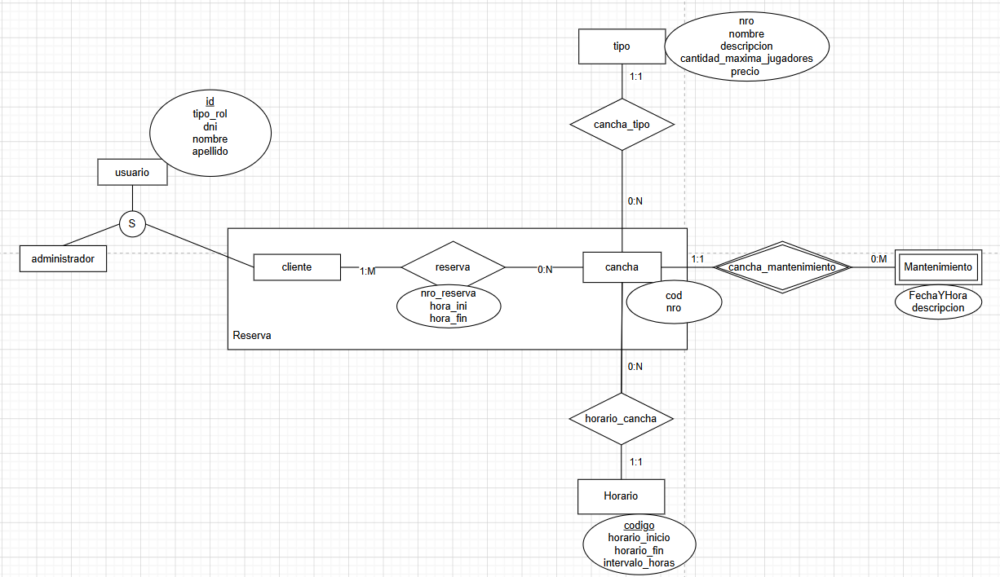

## Propuesta de proyecto | Asignatura: Java | UTN Rosario | 2026

1. ## **Integrantes**

| Legajo | Apellido y nombres |

| 54913 | Campodonico Facundo |

| 54812 | Sopo Juan Esteban |

---

2. ## **Descripción del sistema**

Lution es un sistema web cliente-servidor para la gestión de reservas en complejos deportivos. La plataforma permite a los clientes reservar canchas para distintos deportes, consultando los horarios disponibles antes de confirmar, bajo la supervisión de un rol Administrador que gestiona el catálogo de deportes, canchas y horarios.

El flujo principal permite al cliente iniciar sesión, seleccionar un tipo de deporte y consultar la disponibilidad de las distintas canchas según sus horarios, evitando solapamientos entre reservas. El administrador gestiona los usuarios, los tipos de cancha, las canchas individuales, sus horarios disponibles y las tareas de mantenimiento que bloquean la disponibilidad.

3. ## **Modelo de dominio**

4. ## **Casos de uso para Regularidad**

| Requerimiento | User Story | Descripción breve |
| :---- | :---- | :---- |
| ABMC Simple | ABMC Tipo de Cancha | Alta, baja, modificación y consulta de los tipos de cancha/deporte (entidad simple). |
|  | ABMC Horario | Alta, baja, modificación y consulta de los horarios disponibles (entidad simple). |
| ABMC Dependiente | ABMC Cancha | Gestión de canchas, donde cada cancha depende de un Tipo de Cancha ya existente. |
| CU NO-ABMC | Reserva de Cancha | Reserva verificando que la cancha esté disponible en el día y horario seleccionados (regla de restricción). |
| Listado Simple | Listado de Canchas por Tipo | Listado que muestra canchas junto con su tipo de cancha asociado (dos entidades). |

---

5. ## **Casos de uso para Aprobación Directa**

| Requerimiento AD | User Story | Descripción breve |
| :---- | :---- | :---- |
| ABMC | ABMC Tipo de Cancha | Alta, baja, modificación y consulta de los tipos de cancha/deporte. |
|  | ABMC Horario | Alta, baja, modificación y consulta de los horarios disponibles. |
|  | ABMC Usuario | Gestión de usuarios del sistema, incluyendo su rol (Administrador / Cliente). |
|  | ABMC Cancha | Gestión de canchas; cada cancha depende de un Tipo de Cancha. |
|  | ABMC Mantenimiento | Gestión de tareas de mantenimiento asociadas a una cancha. |
| CU "Complejo" (nivel resumen) | Gestión de Reserva | La reserva ocurre en eventos diferenciados: el cliente consulta la disponibilidad, selecciona horario y confirma la reserva, verificando que no exista solapamiento ni mantenimiento programado. |
| Listado Complejo | Búsqueda de Horarios Disponibles | Listado de canchas y horarios que permite filtrar por tipo de deporte y/o fecha. |
| Nivel de Acceso | Roles: Administrador / Cliente | Acceso diferenciado por rol: el cliente reserva canchas y el administrador gestiona usuarios, deportes, canchas, horarios y mantenimiento. |
| Manejo de errores | Notificación de errores | Manejo de errores en todos los niveles mediante excepciones y bloques try-catch-finally. |

---

